<div align="center">

# ⛏️ Bloco

**Um jogo de blocos estilo sandbox para Nintendo DS e Game Boy Advance, escrito do zero em C.**

Minere, colete, crie ferramentas e construa — em 3D com tela de toque no DS, ou em 2D de lado no GBA.


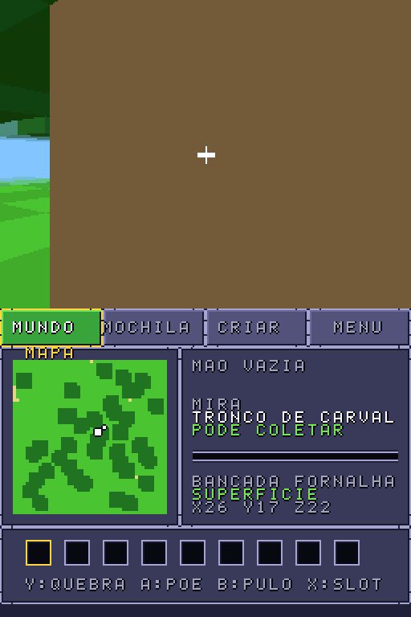&nbsp;&nbsp;&nbsp;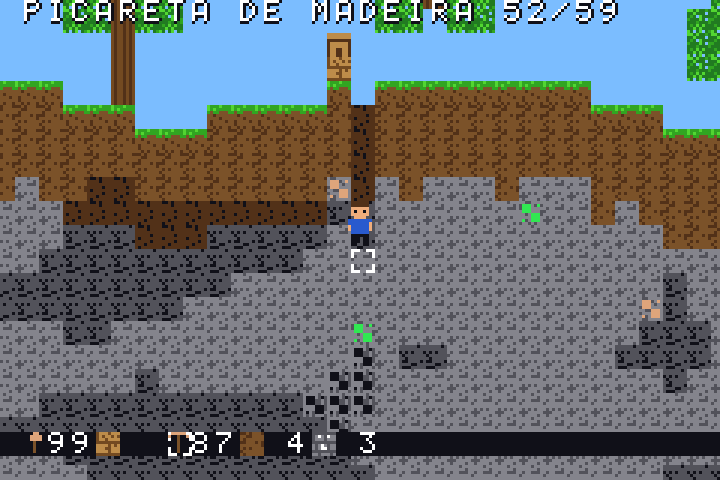

</div>

---

## 🎮 Sobre o jogo

Bloco é um homebrew inspirado em Minecraft, com duas versões que compartilham as mesmas regras de jogo:

| | **BlocoDS** | **BlocoGBA** |
|---|---|---|
| Console | Nintendo DS | Game Boy Advance |
| Visão | 3D em primeira pessoa | 2D de lado |
| Mundo | 48 × 32 × 48 blocos | 256 × 64 blocos |
| Interface | Tela de baixo por toque, com 4 abas | HUD + menu com abas |
| Save | Arquivo `blocods.sav` no cartão (FAT) | SRAM do cartucho |
| Toolchain | BlocksDS (libnds) | devkitARM, sem bibliotecas |

Não usa código nem assets do Minecraft: todos os gráficos, ícones e a fonte são gerados por código.

## ✨ Recursos

- 🌍 **Mundo gerado** com morros, árvores, cavernas, cascalho e 7 minérios distribuídos por profundidade
- ⛏️ **Mineração realista**: tempo de quebra, tier de picareta e drops seguindo a fórmula da Minecraft Wiki
- 🪓 **20 ferramentas**: picareta, machado, pá e espada em madeira, pedra, ferro, ouro e diamante, com durabilidade
- 🎒 **Inventário de 36 slots** e barra rápida de 9
- 🛠️ **Crafting** 2×2, bancada de trabalho e fornalha com combustível
- 🗺️ **Minimapa** no DS, com modo superfície e modo caverna
- 🌱 **Mudas de carvalho**: caem das folhas, são plantadas em grama ou terra e viram árvore com o tempo
- 💾 **Salvar e carregar** o mundo, o inventário e o combustível

## 🕹️ Controles

<table>
<tr><th>Nintendo DS</th><th>Game Boy Advance</th></tr>
<tr valign="top"><td>

| Botão | Ação |
|---|---|
| D-pad | andar |
| L / R | girar |
| Stylus (aba MUNDO) | olhar |
| B | pular |
| Y (segurar) | quebrar |
| A | colocar bloco |
| X | próximo slot |
| SELECT | trocar de aba |
| START | abrir o menu |

</td><td>

| Botão | Ação |
|---|---|
| ← → | andar |
| A ou ↑ | pular |
| B + D-pad | mover a mira |
| R (segurar) | quebrar |
| L | colocar bloco |
| SELECT | próximo slot |
| START | abrir/fechar menu |
| Menu: L / R | trocar de aba |
| Menu: A | pegar/trocar ou criar |
| Menu: SELECT | salvar |
| Menu: L+R+SELECT | novo mundo |

</td></tr>
</table>

## 📸 Screenshots

### Nintendo DS

| Mundo | Coletando | Mapa de caverna |
|:---:|:---:|:---:|
|  | 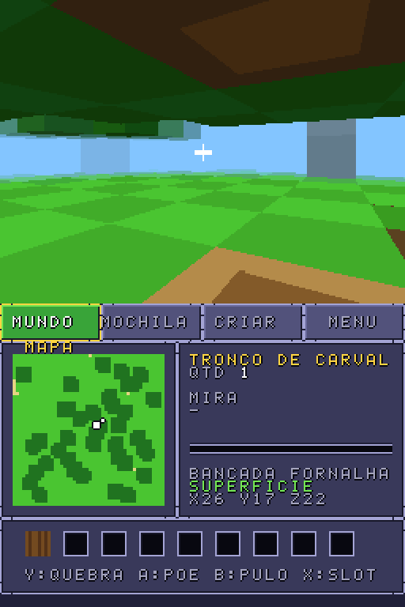 | 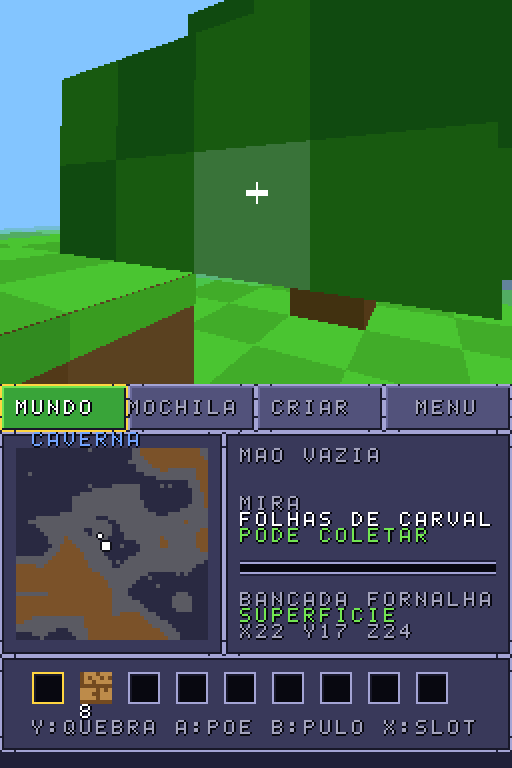 |
| **Mochila** | **Criar** | **Menu** |
| 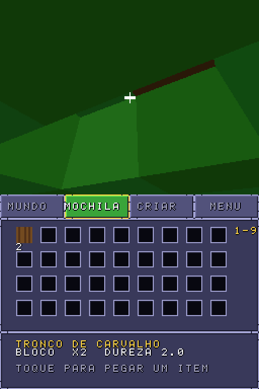 | 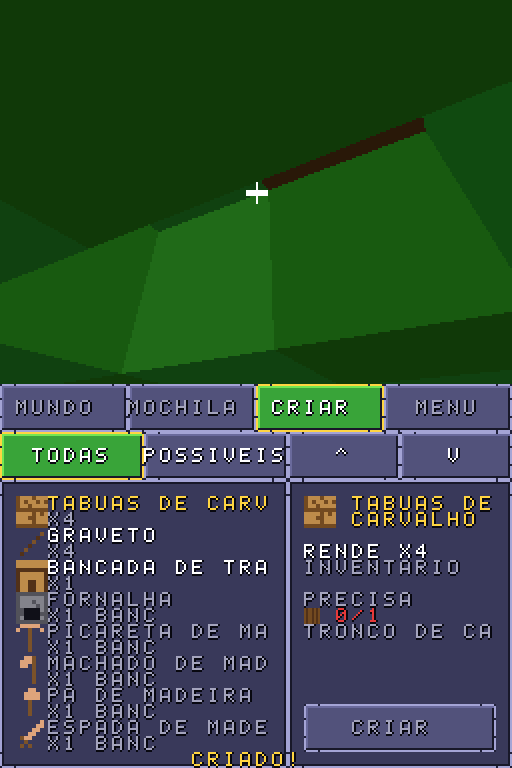 | 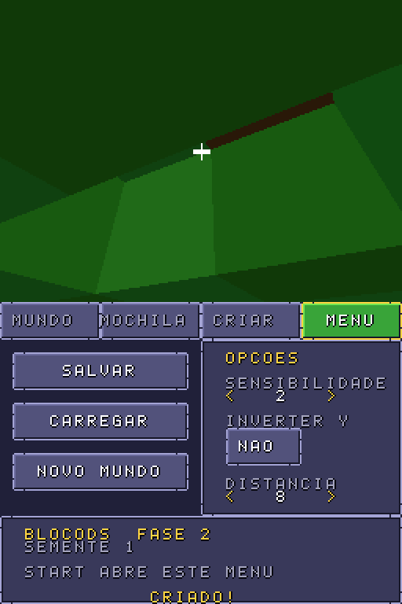 |
| **Muda plantada** | **Virou árvore** | |
| 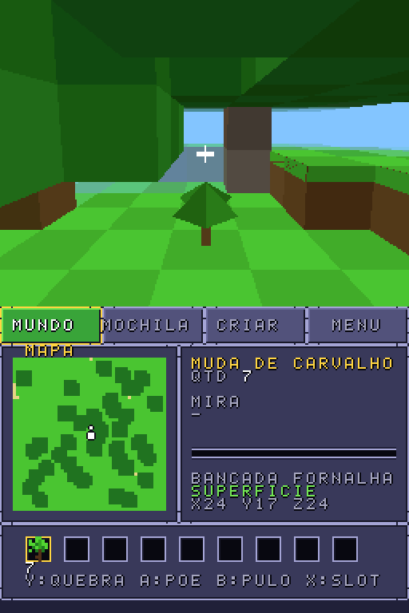 | 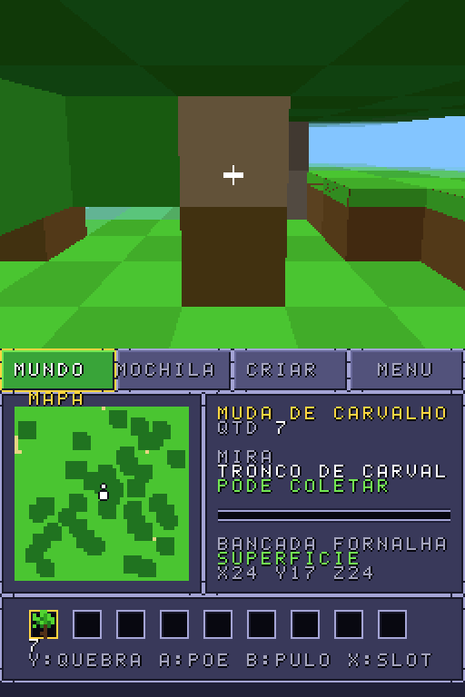 | |

### Game Boy Advance

| Coletando | Cavando |
|:---:|:---:|
| 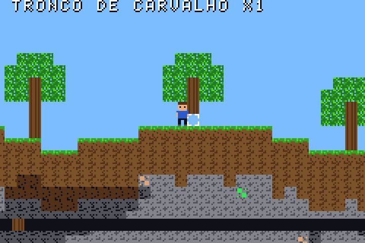 |  |
| **Criar** | **Bancada** |
| 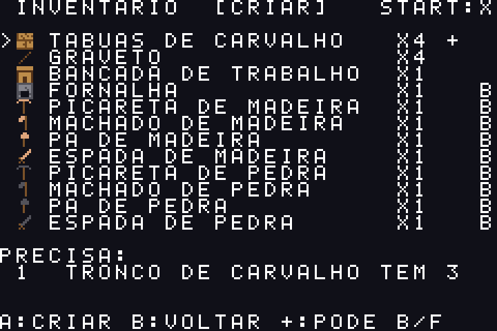 | 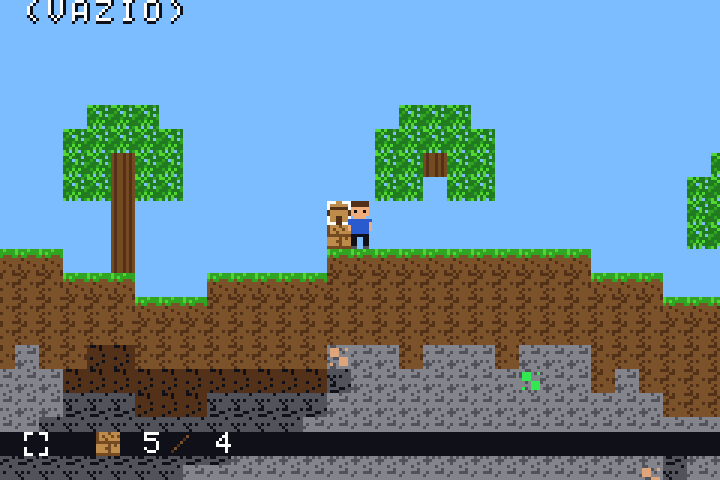 |
| **Jogo salvo** | **Muda plantada** |
| 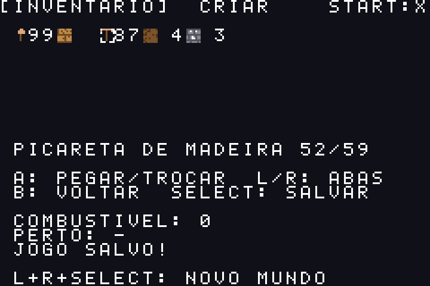 | 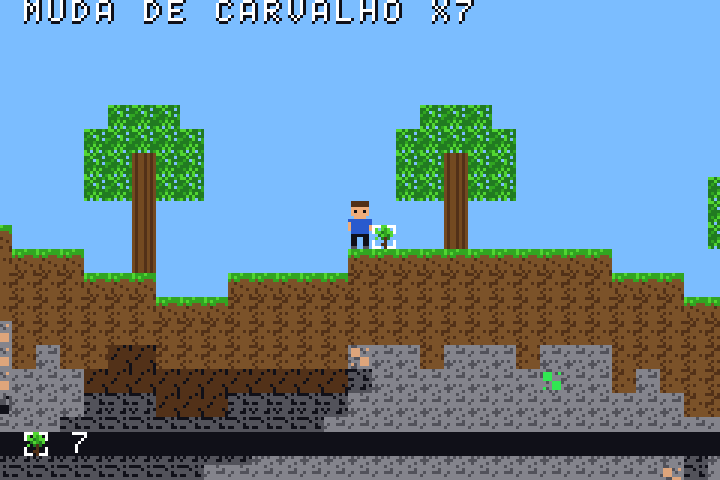 |
| **Virou árvore** | |
| 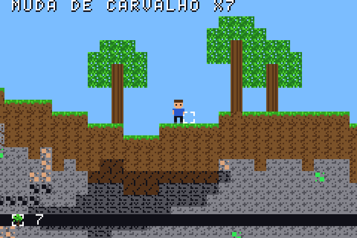 | |

<sub>Prints das ROMs compiladas rodando em emulador. Também dá para gerar prints sem emulador com `make preview`, que roda o código do jogo no PC.</sub>

## 📥 Download

Ainda não há ROMs publicadas em [Releases](https://github.com/hroderik/bloco/releases). Por enquanto, compile seguindo os passos abaixo.

Para jogar:

- **`BlocoDS.nds`**: [melonDS](https://melonds.kuribo64.net/), DeSmuME ou um flashcard. O save precisa de cartão com DLDI.
- **`BlocoGBA.gba`**: [mGBA](https://mgba.io/), VisualBoyAdvance ou um flashcard. Se o emulador perguntar, use save do tipo SRAM.

## 🔧 Como compilar

As três pastas precisam ficar lado a lado:

```
bloco/
├── blococore/   regras compartilhadas: blocos, itens, receitas, mineração, inventário, arte e fonte
├── blocods/     versão 3D para Nintendo DS
└── blocogba/    versão 2D para Game Boy Advance
```

### Com Docker (mais fácil)

Na raiz do repositório:

```sh
# Nintendo DS -> blocods/BlocoDS.nds
docker run --rm -v "$PWD":/work -w /work/blocods skylyrac/blocksds:slim-latest make

# Game Boy Advance -> blocogba/BlocoGBA.gba
docker run --rm -v "$PWD":/work -w /work/blocogba devkitpro/devkitarm:latest make
```

### Com as toolchains instaladas

- **DS**: instale o [BlocksDS](https://blocksds.skylyrac.net/docs/setup/) e rode `make` em `blocods/`.
- **GBA**: instale o [devkitPro com devkitARM](https://devkitpro.org/wiki/Getting_Started) e rode `make` em `blocogba/`.

Detalhes de cada versão, otimizações e como gerar os prints: [`blocods/README.md`](blocods/README.md) e [`blocogba/README.md`](blocogba/README.md).

## 📐 Dados de jogo (Java Edition)

<details>
<summary>Fórmulas e valores usados</summary>

- Tempo de quebra: dano/tick = velocidade ÷ dureza ÷ (30 se pode coletar, senão 100)
- Velocidade: mão 1, madeira 2, pedra 4, ferro 6, diamante 8, ouro 12
- Durabilidade: madeira 59, pedra 131, ferro 250, ouro 32, diamante 1561
- Tier de coleta: pedra/carvão = madeira; ferro/lápis = pedra; ouro/redstone/diamante/esmeralda = ferro
- Combustível: carvão 8 itens, tronco/tábua 1,5, graveto e muda 0,5
- Drops: folhas (muda 5%, graveto 2%, maçã 0,5%), cascalho (pederneira 10%), redstone 4-5, lápis 4-9
- Mudas: crescem por ticks aleatórios com céu aberto acima; ao crescer, a grama embaixo vira terra

</details>

## 🗺️ Roadmap

- [x] Fase 1: mundo, mineração e construção
- [x] Fase 2: sobrevivência básica (ferramentas, crafting, fornalha, save)
- [x] Mudas e crescimento de árvores
- [ ] Mobs, vida e fome
- [ ] Nether e End

**Simplificações atuais:** mundo pequeno com altura comprimida, minérios por profundidade relativa, fornalha que funde na hora usando um estoque global de combustível, e mudas que crescem num estágio só, em cerca de 2 minutos em média (no Java são 2 estágios, uns 16 minutos), sem pó de osso e sem checar luz (só céu aberto).

---

<div align="center">
<sub>Projeto de fã, sem afiliação com a Mojang, a Microsoft ou a Nintendo.</sub>
</div>
